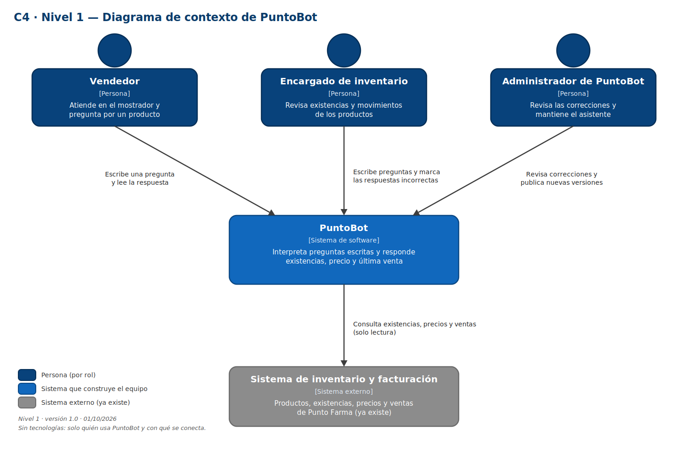

# PuntoBot — Etapa 5

Arquitectura del asistente de consultas de inventario y ventas de Punto Farma. Despliegue local con interfaz de chat, backend, servicio de clasificación y base de datos de consultas.

Equipo: Ricardo José Romero Blandón · Josias Beeri Zeledón Pastrán · Pablo Joshua Castro.

## Entregables

- [Propuesta del proyecto](docs/propuesta.md).
- [Arquitectura y sus documentos](docs/05-arquitectura/README.md).
- [Contratos entre componentes](docs/05-arquitectura/contratos-api.md).
- [Decisión de despliegue local](docs/05-arquitectura/decisiones/ADR-001-despliegue-local.md).
- [Decisión de inferencia inmediata](docs/05-arquitectura/decisiones/ADR-002-inferencia-inmediata.md).
- [Diagramas editables](diagramas/fuente) y [exportaciones PNG y SVG](diagramas/exportados).
- [Lista de revisión](docs/05-arquitectura/lista-verificacion.md) y [trabajo en equipo](docs/05-arquitectura/trabajo-en-equipo.md).

## Diagramas

Los entregables se conservan como fueron proporcionados. La tecnología del sistema de escritorio y del inventario debe confirmarse con la farmacia. La revisión entre integrantes y las tareas de implementación quedan indicadas en los documentos originales.

## Continuidad

- [Etapa 3 — Datos](https://github.com/rebirth18-09/proyecto-ia-puntobot).
- [Etapa 4 — Selección](https://github.com/rebirth18-09/proyecto-ia-puntobot-etapa4).
- [Etapa 6 — Modelo](https://github.com/rebirth18-09/proyecto-ia-puntobot-etapa6).
