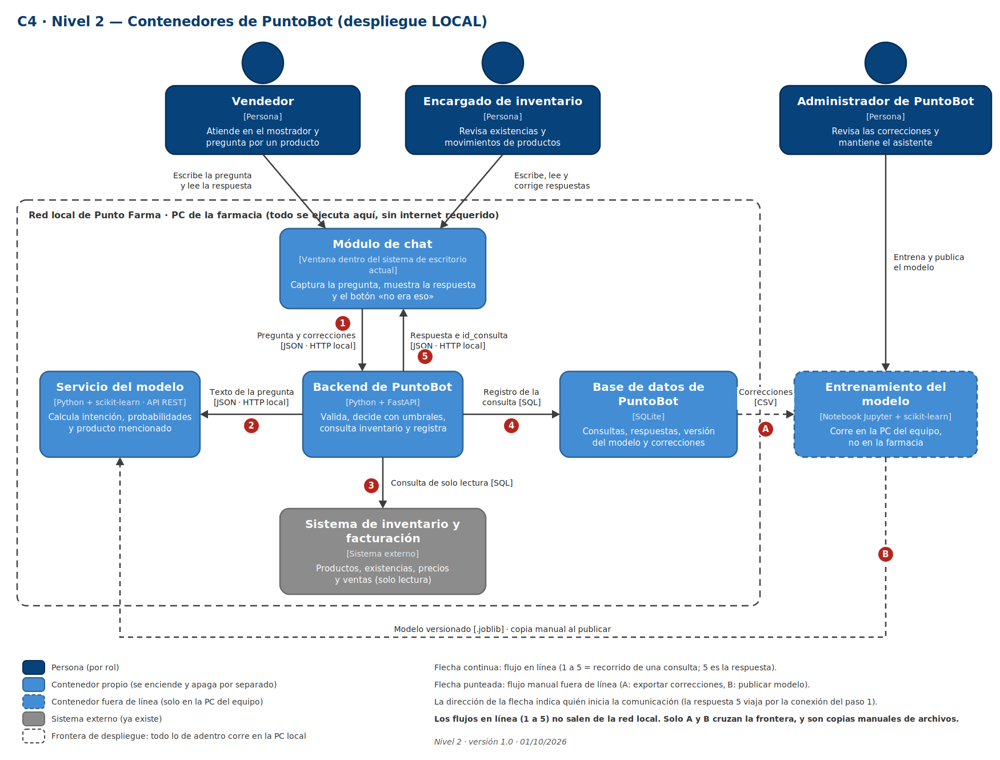

# Nivel 2: contenedores (despliegue local)

Archivo editable: `diagramas/fuente/nivel-2-contenedores.drawio`.

## Contenedores

| Contenedor | Tecnología | Qué hace | Prueba "¿se puede apagar sin apagar lo demás?" |
|---|---|---|---|
| Módulo de chat | Ventana dentro del sistema de escritorio actual (tecnología por confirmar, depende de cómo está hecho ese sistema) | Captura la pregunta, muestra la respuesta y el botón "no era eso" | Sí: se desactiva el módulo y el sistema de la farmacia sigue funcionando como hoy |
| Backend de PuntoBot | Python + FastAPI | Valida, aplica umbrales, consulta inventario y registra | Sí: sin él el chat muestra "PuntoBot no disponible" |
| Servicio del modelo | Python + scikit-learn, expuesto como API REST | Calcula intención, probabilidades y candidatos de producto | Sí: el backend responde "no disponible, use el sistema normal" |
| Base de datos de PuntoBot | SQLite | Guarda consultas, respuestas, versión del modelo y correcciones | Sí: ver contratos, no se muestra respuesta sin registrarla |
| Entrenamiento del modelo | Notebook Jupyter + scikit-learn | Entrena y versiona el modelo; corre en la PC del equipo | Sí: no es parte del sistema en funcionamiento |
| Sistema de inventario y facturación | Externo, ya existe (motor de base de datos por confirmar) | Fuente de productos, existencias, precios y ventas | No es nuestro |

## Frontera de despliegue

Todo lo que está dentro del recuadro punteado corre en la PC de la farmacia, dentro de la red local. El entrenamiento corre fuera, en la PC del equipo.

## Flujo principal (una consulta)

| Paso | Qué ocurre |
|---|---|
| 1 | El módulo de chat envía la pregunta y el rol al backend (JSON por HTTP local). |
| 2 | El backend envía el texto al servicio del modelo (JSON por HTTP local). |
| 3 | El backend consulta existencias, precio o última venta en el sistema de inventario (SQL de solo lectura). |
| 4 | El backend registra la consulta en la base de datos de PuntoBot (SQL). |
| 5 | El backend responde al chat con el texto de respuesta y el id de la consulta. |

Flujos fuera de línea: **A**, el administrador exporta las correcciones (CSV) para reentrenar; **B**, el modelo versionado (.joblib) se copia a mano al servicio del modelo al publicar. Son los únicos que cruzan la frontera y no llevan datos de clientes.

## Coherencia con el Nivel 1

Aparecen las mismas tres personas y el mismo sistema externo. Lo único nuevo es el interior de PuntoBot.
